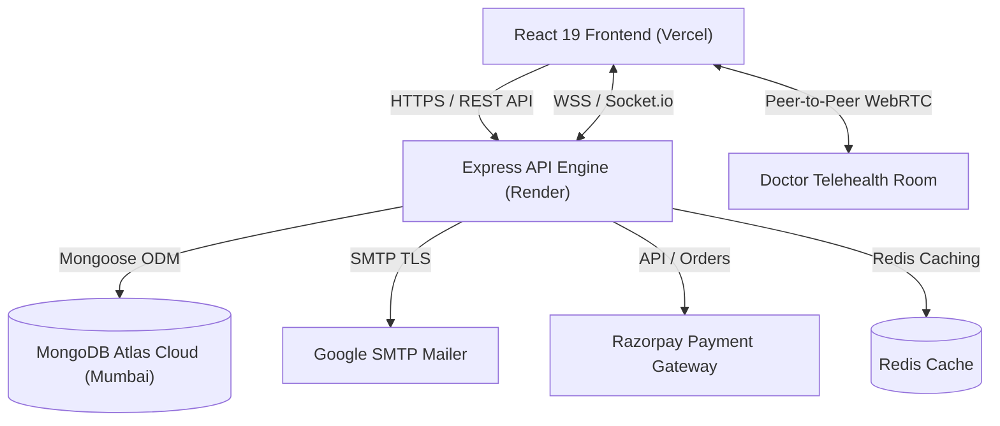

# 🏥 MediCare360 — Connected Healthcare Ecosystem & Telemedicine Platform

[](https://mdi-care360.vercel.app/)
[](https://mdicare360.onrender.com/api/health)
[](https://www.mongodb.com/cloud/atlas)
[](https://react.dev/)
[](https://nodejs.org/)
[](https://opensource.org/licenses/MIT)

> **MediCare360** is a full-stack, enterprise-grade healthcare ecosystem designed to bridge patients, medical doctors, diagnostic labs, pharmacies, and society administrators under a unified, real-time platform. Features WebRTC HD video consultations, automated slot booking, Razorpay UPI payments, digital prescriptions, lab test reports, and an executive administration suite.

---

## 🌐 Live Production Deployments

| Component | Platform | Live URL |
| :--- | :--- | :--- |
| **Frontend Web Client** | **Vercel** | [https://mdi-care360.vercel.app/](https://mdi-care360.vercel.app/) |
| **Backend API Engine** | **Render** | [https://mdicare360.onrender.com/api](https://mdicare360.onrender.com/api) |
| **API Health Status** | **Render** | [https://mdicare360.onrender.com/api/health](https://mdicare360.onrender.com/api/health) |
| **Cloud Database** | **MongoDB Atlas** | Cluster: `ap-south-1` (Mumbai) |

---

## 🌟 Key Platform Modules & Portals

### 🧑‍⚕️ 1. Doctor Practice Suite (`/doctor/*`)
- **Interactive Workspace**: View upcoming consultations, patient queue, and clinical metrics.
- **WebRTC Telemedicine**: Built-in peer-to-peer secure HD video consultation with chat and real-time clinical notes.
- **Slot & Availability Engine**: Configure working hours, buffer times, slot intervals, and block leave dates with duplicate-prevention constraints.
- **Digital E-Prescriptions**: Prescribe medicines with dosage, frequency, duration, and patient instructions; automatically linked to patient health vaults.
- **Patient Electronic Health Records (EHR)**: Inspect longitudinal patient records, lab test history, and consultation summaries.
- **Financial Analytics & Earnings**: Track completed consultations, earnings breakdowns, and verified payouts.

### 👤 2. Patient Healthcare Portal (`/patient/*`)
- **Doctor Discovery**: Search specialists by clinical domain (Cardiology, Dermatology, Neurology, Pediatrics, Orthopedics, etc.), experience, fee, and rating.
- **One-Click Appointments**: Book real-time consultation slots (Online Video or In-Person Clinic visits).
- **Integrated Payments & UPI**: Seamless checkout powered by Razorpay (UPI, Google Pay, PhonePe, Cards, Net Banking).
- **Diagnostic Labs**: Browse test catalog (Lipid Profile, CBC, HbA1c, Thyroid Panel), book home sample collections, and download released test reports.
- **E-Pharmacy**: Browse medicines, place prescription orders, track deliveries, and view invoices.
- **Health Metrics Vault**: Log blood pressure, glucose, heart rate, and BMI with interactive trend tracking.
- **Consent Governance**: Granular control over which doctors can access medical records, with instant revocation rights.

### 🛡️ 3. Platform Administration Command Center (`/admin/*`)
- **Executive Operations Dashboard**: High-impact KPI ribbon, continuous 6-month consultation trajectory chart (`AreaChart`/`BarChart`), and role composition donut chart.
- **Full Ecosystem CRUD**:
  - **User Management**: Search, filter by role, activate/disable, reset passwords, or onboard new members.
  - **Doctor Credentials Verification**: Inspect medical council registration numbers, credentials, and approve/reject doctors.
  - **Hospital & Center Management**: Manage hospitals, diagnostic labs, and pharmacies with branch details and department heads.
- **System & Security Hub**: Real-time tamper-evident audit logs, operational health radars (Atlas, Razorpay, WebSockets), and an 8-tab system settings suite.

### 🧪 4. Diagnostic Lab Portal (`/lab/*`)
- Manage diagnostic test catalogs, pricing, sample requirements, and turnaround times.
- Review incoming test bookings, assign phlebotomists, and upload verified digital lab reports.

### 💊 5. Pharmacy Portal (`/pharmacy/*`)
- Maintain medicine catalog, stock levels, batch numbers, and reorder levels.
- Process incoming doctor e-prescriptions, fulfill orders, and track dispatches.

---

## 🛠️ Technology Stack

| Layer | Technologies |
| :--- | :--- |
| **Frontend** | React 19, Vite 8, Redux Toolkit, React Router DOM v7, Recharts, React Hot Toast, Date-fns |
| **Backend** | Node.js v20+, Express.js v5, Socket.io, Multer, Helmet, CORS, Express Rate Limit |
| **Database** | MongoDB Atlas Cloud, Mongoose v9 (Replica Set, GeoJSON coordinates, Unique Slot Indexes) |
| **Caching / Sessions** | Redis / In-Memory Graceful Fallback |
| **Realtime Video / Chat** | WebRTC Peer Connection, Socket.io Signaling Engine |
| **Payments Gateway** | Razorpay (UPI Intent, QR, Cards, NetBanking with HMAC-SHA256 signature verification) |
| **Email & Notifications**| Google SMTP (TLS / Port 587) with Nodemailer automated booking notifications |
| **Hosting & CI/CD** | Vercel (Frontend Global Edge CDN), Render (Backend Containerized Web Service) |

---

## 🏗️ Architecture Overview



---

## 🚀 Local Development Setup

### 1. Prerequisites
- **Node.js**: v18.0.0 or higher
- **npm**: v9.0.0 or higher
- **MongoDB**: Local MongoDB instance or MongoDB Atlas Cloud URI

### 2. Clone the Repository
```bash
git clone https://github.com/bharathkumar2705/MdiCare360.git
cd MdiCare360
```

### 3. Backend Setup
```bash
cd server
npm install
```

Create a `.env` file in the `server` directory:
```env
PORT=5000
NODE_ENV=development
MONGO_URI=your_mongodb_connection_string
JWT_SECRET=your_jwt_secret_key
JWT_REFRESH_SECRET=your_jwt_refresh_secret_key
JWT_EXPIRES_IN=15m
JWT_REFRESH_EXPIRES_IN=7d
CLIENT_URL=http://localhost:5173

# Email Notifications (Google SMTP)
EMAIL_HOST=smtp.gmail.com
EMAIL_PORT=587
EMAIL_USER=your_email@gmail.com
EMAIL_PASS=your_gmail_app_password
EMAIL_FROM=MediCare360 <noreply@medicare360.com>

# Payments (Razorpay)
RAZORPAY_KEY_ID=your_razorpay_key_id
RAZORPAY_KEY_SECRET=your_razorpay_key_secret
```

Seed initial sample doctors, hospitals, and users:
```bash
npm run seed
```

Start the backend server:
```bash
npm run dev
```
Backend will start on: `http://localhost:5000`

---

### 4. Frontend Setup
In a new terminal window:
```bash
cd client
npm install
```

Create a `.env` file in the `client` directory:
```env
VITE_API_URL=http://localhost:5000/api
VITE_SOCKET_URL=http://localhost:5000
VITE_RAZORPAY_KEY_ID=your_razorpay_key_id
```

Start the Vite development server:
```bash
npm run dev
```
Frontend will be available at: `http://localhost:5173`

---

## 🔑 Default Seed Credentials (Local / Testing)

| Role | Email | Password |
| :--- | :--- | :--- |
| **Platform Administrator** | `admin@medicare360.com` | `Admin@123456` |
| **Doctor** | `dr.sharma@medicare360.com` | `Doctor@123456` |
| **Patient** | `patient@medicare360.com` | `Patient@123456` |
| **Hospital Administrator** | `hospital.admin@medicare360.com` | `Hospital@123456` |
| **Lab Administrator** | `lab.admin@medicare360.com` | `LabAdmin@123456` |
| **Pharmacy Administrator** | `pharmacy.admin@medicare360.com` | `Pharmacy@123456` |

---

## 🔒 Security & Best Practices

- **Strict Secret Isolation**: `.env` and sensitive production secrets are permanently excluded via `.gitignore`.
- **Stateless Authentication**: Access tokens (15-min expiry) paired with rotating refresh tokens (7-day expiry).
- **Double-Booking Prevention**: MongoDB partial unique compound indexes on `(doctorId, date, slotTime)` ensure zero scheduling collisions.
- **Payment Verification**: Server-side HMAC-SHA256 signature verification protects against client-side tampering of Razorpay transactions.
- **Audit Logging**: Sensitive data modifications, logins, profile updates, and consent grants write structured immutable entries to the `AuditLog` collection.
- **CORS & Rate Limiting**: Helmet security headers and IP-based rate limiting guard against brute-force attacks and abuse.

---

## 📄 License
This project is open-source and licensed under the [MIT License](LICENSE).

---

## 👨‍💻 Author & Acknowledgements
- **Lead Developer**: [Bharath Kumar Reddy](https://github.com/bharathkumar2705)
- **Repository**: [https://github.com/bharathkumar2705/MdiCare360](https://github.com/bharathkumar2705/MdiCare360)
- **Live Platform**: [https://mdi-care360.vercel.app](https://mdi-care360.vercel.app)
